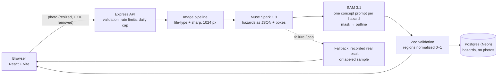

# aegis-home

A Spanish-first web app for Latin American families that turns photos of an older adult's home into a **visual, prioritized, locally-costed fall-prevention plan**.

Built for the **Meta Global AI Developer Hackathon 2026** · Indie Developer track · _Build for Your World_.

- **App:** https://client-eight-psi-67.vercel.app
- **API health:** https://aegis-home-api.onrender.com/health (free tier: the first request after a while can take ~1 minute to wake up)

## The problem

Falls are a leading cause of injury among older adults, and many of them happen at home: a wet bathroom floor, a loose rug, stairs without a handrail. A professional home-safety assessment means an in-person visit that most families in Central America can't easily get, and the tools that do this from photos are in English and priced for the US.

**Who it helps:** an adult son, daughter or grandchild checking a parent's or grandparent's home, often from a distance, in Spanish, with fixes that use cheap materials available locally.

## How it works

1. A family member photographs a room (or taps **"Usar imagen de prueba"** to try a bundled sample).
2. **Muse Spark** looks at the photo and returns the visible environmental hazards as validated JSON: label, severity, what to do in simple Spanish, a rough cost in USD, and a grounding box.
3. **SAM 3.1** gets each hazard's short label as a concept prompt and segments the object; the instance whose box best matches Spark's box is chosen, and its pixel mask is traced into an outline so the photo shows the exact shape of the rug or cable, not just a rectangle. If SAM finds nothing (common for _missing_ things like a grab bar), Spark's box is used.
4. The app builds an action plan ordered by severity, with "Ya lo arreglé" tracking, pending cost, and a quick-contact button (call / WhatsApp / SMS) to the family's own contacts.



Photos are processed in memory and **never stored**; only the hazard text and regions are saved.

## Features

- Room-by-room analysis with hazards highlighted on the photo (numbered markers, tap to select).
- Prioritized action plan: high → low severity, progress bar, pending cost, resolve / undo.
- Quick-contact button: up to 3 contacts saved only on the device; call, WhatsApp or SMS with a prefilled message; location is added only if the user ticks the box.
- Bundled sample images for an instant demo, with real recorded results if the API is down.
- Shareable private link per household (anyone with the link can see it, and the app says so), expiry after 30 days, and a "delete my data" button.
- Fallback that is always labeled: a banner appears whenever a result didn't come from a live model call.

## Tech stack

React 19 + Vite + Tailwind 4 + TanStack Query (TypeScript) · Node.js 22 + Express 5 (TypeScript, tsx) · PostgreSQL on Neon + Prisma 7 · Zod 4 · sharp · Meta Model API (`muse-spark-1.3`, `sam-3.1`, masks decoded with Meta's [`@meta-sam/parser`](https://www.npmjs.com/package/@meta-sam/parser), SAM License) · Vercel · Render · Vitest (with in-memory Postgres via PGlite).

## Local development

Requires Node.js 22.12+ and a Postgres database (a free Neon project works).

```bash
npm install
cp .env.example server/.env   # fill in DATABASE_URL and the META_* values
npm run db:deploy -w server
npm run dev:server            # http://localhost:3000
npm run dev:client            # http://localhost:5173
```

| Variable                    | Purpose                                                                      |
| --------------------------- | ---------------------------------------------------------------------------- |
| `DATABASE_URL`              | Postgres connection string (`sslmode=verify-full`)                           |
| `FRONTEND_URL`              | Allowed CORS origin                                                          |
| `META_API_KEY`              | Meta Model API key (`LLM_…`); backend only, never in `VITE_*`                |
| `META_API_BASE_URL`         | `https://api.meta.ai/v1`                                                     |
| `META_MODEL_SPARK` / `_SAM` | `muse-spark-1.3` (Standard data mode) / `sam-3.1`                            |
| `MOCK_AI`                   | `true` skips Meta entirely and serves labeled fallback results               |
| `AI_DAILY_CALL_CAP`         | Outbound Meta calls per UTC day (1 per Spark attempt + 1 per hazard for SAM) |
| `HOUSEHOLD_TTL_DAYS`        | Days before a household and its data expire                                  |
| `VITE_API_URL` (client)     | API origin used by the frontend                                              |

## Tests

```bash
npm run typecheck
npm run lint
npm test                                                   # server + client
npm run smoke-test -w server -- https://<api-url>          # after each deploy
npm run record-fixture -w server -- <image> <room_type>    # record a real result as fallback
```

The server suite covers the Spark output contract, the Spark↔SAM join, SAM output parsing, the fallback ladder (429, timeout, invalid JSON, daily cap), image validation, household scoping (404 for foreign resources) and rate limits. CI (`.github/workflows/ci.yml`) runs the checks plus a gitleaks secret scan on every push.

## Deployment

| Part       | Host                      | Config                                                                                           |
| ---------- | ------------------------- | ------------------------------------------------------------------------------------------------ |
| API        | Render (free web service) | [`render.yaml`](render.yaml): build runs migrations; health check `/health`                      |
| Frontend   | Vercel                    | Root directory `client`; [`client/vercel.json`](client/vercel.json) sets CSP and privacy headers |
| Database   | Neon Postgres             | `DATABASE_URL` with `sslmode=verify-full`                                                        |
| Keep-alive | UptimeRobot               | `GET /health` every 5 minutes                                                                    |

## Security and privacy

- No accounts: each household gets a random token sent in a header; every query is scoped to it, and other households' resources return 404.
- Uploads: 5 MB limit, MIME allow-list plus magic-byte check, decompression-bomb limit, re-encoded and resized before reaching the model. Photos stay in memory only.
- Model output is untrusted: validated with bounded Zod schemas, rendered as plain text, never triggers actions. The prompt tells Spark to ignore text inside the image.
- Abuse and cost: global and per-route rate limits, at most 2 analyses at once, and a daily cap on Meta calls stored in the database.
- Logs record route, status, duration and analysis source; never bodies, images, tokens or hazard text.
- Frontend: strict CSP, `Referrer-Policy: no-referrer`, `noindex`, no secrets in the bundle.
- `npm audit --omit=dev` is clean. The remaining moderate advisories are in the ESLint toolchain (`minimatch`) and only affect linting.
- Out of scope on purpose: login/OAuth, WAF, penetration testing, compliance certifications, medical-device regulation.

Details: [docs/SECURITY.md](docs/SECURITY.md).

## Honest limitations

- **Not medical advice.** It reports environmental hazards only; it doesn't diagnose, detect falls, or act as an emergency or monitoring service.
- Hazard detection is AI-generated and can miss risks or flag false ones; costs are rough estimates.
- Photos are sent to Meta's Model API for analysis (Standard mode: not used for training).
- A hazard that is something _missing_ (no mask to find) is boxed where it should be. Outlines keep the largest part of the mask and are simplified to at most 100 points.

## Provenance

All code in this repository was written during the hackathon (Oct 27 – Nov 4, 2026). Reused code from earlier work: none.

The two sample images in `client/public/samples/` (a living room and a bedroom) are AI-generated, created by the project author for this hackathon; they do not depict a real home. They show no people and carry no metadata (EXIF/GPS removed). The recorded results in `server/fixtures/<sha256>[.pt|.en].json` come from live Muse Spark + SAM 3.1 calls on those photos, in Spanish, Portuguese and English.

## Documentation

- [Context](docs/CONTEXT.md)
- [Architecture](docs/ARCHITECTURE.md)
- [Data model](docs/DATA_MODEL.md)
- [AI integration](docs/AI_INTEGRATION.md)
- [API specs](docs/API_SPECS.md)
- [Security](docs/SECURITY.md)
- [Development plan](docs/DEVELOPMENT_PLAN.md)
