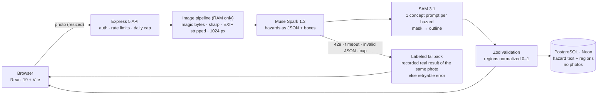

<div align="center">

# aegis-home

**Snap a photo of an older adult's home. Get a visual, prioritized, low-cost fall-prevention plan, in Spanish.**

[](https://aegishome.vercel.app)
[](https://aegis-home-api.onrender.com/health)

[](LICENSE)


**Meta Global AI Developer Hackathon 2026** · Indie Developer track · _Build for Your World_

[Live demo](https://aegishome.vercel.app) · [Demo video (3 min)](TODO) · [Architecture](docs/ARCHITECTURE.md) · [AI integration](docs/AI_INTEGRATION.md)

</div>

---

## Table of contents

- [The problem](#the-problem)
- [The solution](#the-solution)
- [Key features](#key-features)
- [How we use Meta's models](#how-we-use-metas-models)
- [Architecture](#architecture)
- [Privacy & security by design](#privacy--security-by-design)
- [Why Spanish, Portuguese and English](#why-spanish-portuguese-and-english)
- [Tech stack](#tech-stack)
- [Quickstart](#quickstart)
- [API overview](#api-overview)
- [Testing & quality](#testing--quality)
- [Honest limitations](#honest-limitations)
- [Built during the hackathon](#built-during-the-hackathon)
- [Disclaimer, license & credits](#disclaimer-license--credits)

---

## The problem

- Falls are the **second leading cause of unintentional injury deaths worldwide**, and adults over 60 suffer the most fatal falls ([WHO](https://www.who.int/news-room/fact-sheets/detail/falls)). Many happen at home: a wet floor, a loose rug, a cable across the walkway.
- A professional home-safety assessment means an in-person visit that most families in Central America can't get. The digital tools that exist are **in English, priced for the US, and recommend products that aren't sold locally**.
- The person who worries is often an adult child or grandchild **living in another city or country**.

## The solution

A family member photographs a room. **Muse Spark** finds the visible environmental hazards and writes a plain-language fix with local, low-cost materials. **SAM 3.1** outlines each hazard on the photo with its real shape. The result is a prioritized action plan the family can share and track. **Photos are never stored.**

> From photo to plan in under a minute. No account, no app install, no photo kept on any server.

---

## Key features

|     | Feature                              | What it does                                                                                                                                           |
| --- | ------------------------------------ | ------------------------------------------------------------------------------------------------------------------------------------------------------ |
| 📸  | **Hazards outlined on the photo**    | Spark detects and explains; SAM 3.1 traces the exact outline of each object (the rug, the cable, the chair) and measures how much of the **visible floor** it covers ("Ocupa el 28 % del piso visible"). Tap a numbered marker to see the details. |
| 📋  | **Prioritized action plan**          | High → low severity, a materials list per fix, estimated cost, a "Ya lo arreglé" toggle with undo, progress bar and room filter.                       |
| 👨‍👩‍👧  | **Built for families at a distance** | Private share link per household; a quick-contact button (call, WhatsApp, SMS) to up to 3 contacts that are stored **only on the device**.             |
| 🌎  | **Multilingual AI output**           | Spanish, Portuguese and English: the UI **and** the model's descriptions, fixes and materials come back in the chosen language.                        |

Also included: a camera button for phones, two bundled sample rooms for an instant demo, light/dark themes, and a "delete my data" button.

---

## How we use Meta's models

Two models in sequence, each doing what it is best at:

| Step          | Model                        | Input                                             | Output                                                                                                                        |
| ------------- | ---------------------------- | ------------------------------------------------- | ----------------------------------------------------------------------------------------------------------------------------- |
| 1. Understand | **Muse Spark 1.3** (vision)  | Normalized photo + room hint + language           | Up to 8 hazards as **schema-constrained JSON**: label, severity, description, fix, materials, cost, confidence, grounding box |
| 2. Locate     | **SAM 3.1** (concept prompt) | Each hazard's short English label (`"loose rug"`) | Every matching instance, with boxes and **pixel masks**                                                                       |
| 3. Join       | Server                       | Spark box ↔ SAM instances                         | The instance that best overlaps Spark's box wins; its mask becomes an **outline polygon**                                     |

**Engineering details:**

- **Constrained decoding.** Spark is called with `response_format: json_schema`, then re-validated with Zod. On invalid JSON it gets one strict retry, then the fallback.
- **Grounded instance matching.** A concept prompt like "rug" returns _every_ rug. We pick the one whose box has the best IoU with Spark's box, so the outline matches the hazard Spark described.
- **Mask → polygon.** Masks are decoded with Meta's official [`@meta-sam/parser`](https://www.npmjs.com/package/@meta-sam/parser). We keep its main pieces (a rug split by a table keeps both halves), simplify them (Ramer–Douglas–Peucker) to ≤ 100 vertices in total, and normalize them to 0–1.
- **Floor share, a metric only masks can give.** Spark flags hazards on the walking surface; one extra SAM call segments the `"floor"` in parallel; the walkway is the floor plus every floor-level hazard, and each hazard's share is its area over that walkway, on a raster grid. A boxes-only pipeline couldn't measure this.
- **Graceful degradation.** If SAM finds nothing (common for _missing_ things like a grab bar), the region falls back to Spark's box. A failed SAM call never fails the room.
- **Shared pixel space.** Both models see the _same_ 1024 px re-encoded image, so their coordinates line up.

---

## Architecture



```
┌─────────────┐   ┌──────────────────────┐   ┌──────────────────────┐   ┌──────────────┐
│  Frontend   │──▶│  Node.js + Express 5  │──▶│  Meta Model API      │   │  PostgreSQL  │
│  Vercel     │   │  Render · in-memory   │   │  Spark 1.3 → SAM 3.1 │   │  Neon        │
│  strict CSP │◀──│  pipeline · Zod       │◀──│  (validated output)  │   │  text only   │
└─────────────┘   └──────────┬───────────┘   └──────────────────────┘   └──────▲───────┘
                             └────────────────── Prisma 7 ───────────────────────┘
```

### Pragmatic architecture decisions

| Decision                                       | Why it matters in a 7-day build                                                                         |
| ---------------------------------------------- | ------------------------------------------------------------------------------------------------------- |
| **Sequential pipeline: Spark → SAM by label**  | No guessing which mask belongs to which description; each SAM call answers one hazard.                  |
| **Photos processed in RAM, never persisted**   | No object storage to secure, nothing sensitive to leak, a simpler privacy story.                        |
| **Model output treated as untrusted input**    | Bounded Zod schemas, plain-text rendering, no actions triggered by model output.                        |
| **Relational model (Postgres + Prisma)**       | Household → assessment → room → hazard maps directly to the domain; every query is scoped by household. |
| **Token-per-household instead of accounts**    | Zero sign-up friction for older adults' families; the token is a random UUID sent in a header.          |
| **Always-labeled fallback ladder**             | The bundled samples survive outages; a non-live result is always labeled, and another room's sample is never shown on a user's photo.                     |
| **Daily cap on Meta calls, stored in the DB**  | A hard budget brake that survives restarts; when it's hit, the app degrades instead of spending.        |
| **Free-tier hosting (Vercel + Render + Neon)** | ~$0 infrastructure; the only variable cost is model calls, which the cap controls.                      |

---

## Privacy & security by design

- **Zero photos stored.** Images live only in memory during the analysis. They are re-encoded with `sharp`, which **strips EXIF/GPS**, and resized before reaching the model. Only hazard text and normalized regions are saved.
- **Everything is validated server-side with Zod.** Uploads are checked with a MIME allow-list, magic bytes, a 5 MB limit and a decompression-bomb pixel limit. Model output is checked against bounded schemas. The prompt tells Spark to **ignore any text inside the image** (prompt-injection defense).
- **Least data, least exposure.** No accounts. Contacts stay on the device. Households expire after 30 days and can be deleted with one button. Logs never contain bodies, images, tokens or hazard text. The frontend has a strict CSP, `no-referrer` and `noindex`.

Abuse and cost controls: per-route rate limits, at most 2 concurrent analyses, a daily AI call cap, and a gitleaks secret scan in CI. Full threat model: [docs/SECURITY.md](docs/SECURITY.md).

---

## Why Spanish, Portuguese and English

| Language                 | Why it's there                                                                                                                                                                                |
| ------------------------ | --------------------------------------------------------------------------------------------------------------------------------------------------------------------------------------------- |
| 🇸🇻 **Spanish (default)** | The primary audience: families in Central America and Latin America, writing in simple, neutral Latin American Spanish.                                                                       |
| 🇧🇷 **Portuguese**        | **Brazil has the largest older-adult population in Latin America** (~32 million people aged 60+, IBGE Census 2022). Supporting it widens the reach across the region at almost no extra cost. |
| 🇺🇸 **English**           | Bilingual and diaspora families, and reviewers. The app follows the browser language, so an English-speaking visitor sees it in English automatically.                                        |

This isn't just translated UI strings: **Muse Spark writes the hazard descriptions, fixes and materials in the selected language.** The same photo yields a native-language plan in each one.

---

## Tech stack

| Layer                 | Technologies                                                                                                  |
| --------------------- | ------------------------------------------------------------------------------------------------------------- |
| **Frontend**          | React 19 · Vite · TypeScript · Tailwind CSS 4 · TanStack Query                                                |
| **Backend**           | Node.js 22 · Express 5 · TypeScript (tsx) · sharp · Zod 4 · helmet                                            |
| **Database**          | PostgreSQL (Neon) · Prisma 7                                                                                  |
| **AI models**         | Meta Model API: `muse-spark-1.3` (Standard data mode, not used for training) · `sam-3.1` · `@meta-sam/parser` |
| **Testing**           | Vitest · PGlite (in-memory Postgres) · smoke test against the deployed API                                    |
| **DevOps & security** | GitHub Actions (typecheck, lint, tests, gitleaks) · Vercel · Render · UptimeRobot keep-alive                  |

---

## Quickstart

**Requirements:** Node.js 22.12+ and a PostgreSQL database (a free [Neon](https://neon.tech) project works).

1. **Clone and install**
   ```bash
   git clone https://github.com/KarlaPocasangre/aegis-home.git
   cd aegis-home
   npm install
   ```
2. **Configure the environment**
   ```bash
   cp .env.example server/.env          # backend
   cp .env.example client/.env.local    # frontend (only VITE_API_URL is read)
   ```
   Fill in `DATABASE_URL` and, for live AI, the `META_*` values.
3. **Run the database migrations**
   ```bash
   npm run db:deploy -w server
   ```
4. **Start in development mode** (two terminals)
   ```bash
   npm run dev:server   # http://localhost:3000
   npm run dev:client   # http://localhost:5173
   ```

> **Mock mode (no Meta API key needed):** set `MOCK_AI=true` in `server/.env` (the default in `.env.example`). Every analysis returns recorded or sample results, clearly labeled with a banner, and no call reaches Meta.

### Environment variables

| Variable                              | Purpose                                                                      |
| ------------------------------------- | ---------------------------------------------------------------------------- |
| `DATABASE_URL`                        | Postgres connection string (`sslmode=verify-full`)                           |
| `FRONTEND_URL`                        | Allowed CORS origin                                                          |
| `META_API_KEY`                        | Meta Model API key; **backend only, never in `VITE_*`**                      |
| `META_API_BASE_URL`                   | `https://api.meta.ai/v1`                                                     |
| `META_MODEL_SPARK` / `META_MODEL_SAM` | `muse-spark-1.3` / `sam-3.1`                                                 |
| `MOCK_AI`                             | `true` skips Meta and serves labeled fallback results                        |
| `AI_DAILY_CALL_CAP`                   | Outbound Meta calls per UTC day (1 per Spark attempt + 1 per hazard for SAM) |
| `HOUSEHOLD_TTL_DAYS`                  | Days before a household and its data expire                                  |
| `VITE_API_URL` (client)               | API origin used by the frontend                                              |

---

## API overview

All `/api` routes except household creation require the `X-Household-Token` header. Resources from other households return **404**.

| Method   | Endpoint                     | Description                                                      | Limit                               |
| -------- | ---------------------------- | ---------------------------------------------------------------- | ----------------------------------- |
| `GET`    | `/health`                    | Liveness check                                                   | none                                |
| `POST`   | `/api/households`            | Create a household; returns its access token                     | 10 / h / IP                         |
| `GET`    | `/api/households/me`         | Current household                                                | global                              |
| `DELETE` | `/api/households/me`         | Delete the household and all its data                            | global                              |
| `POST`   | `/api/assessments`           | Start an assessment                                              | global                              |
| `GET`    | `/api/assessments/:id`       | Assessment with rooms, hazards and regions                       | global                              |
| `POST`   | `/api/assessments/:id/rooms` | Upload a photo (`multipart`, ≤ 5 MB) → live Spark + SAM analysis | 5 / min / IP · 20 / day / household |
| `PATCH`  | `/api/hazards/:id`           | Mark a hazard resolved or pending                                | global                              |

Global limit: 100 requests / 15 min / IP. Full contract, error codes and payloads: [docs/API_SPECS.md](docs/API_SPECS.md).

---

## Testing & quality

```bash
npm run typecheck && npm run lint && npm test
npm run smoke-test -- https://<api-url>                      # after each deploy
npm run record-fixture -w server -- <image> <room_type> [es|pt|en]   # record a real result as fallback
```

The server suite covers the Spark output contract, Spark ↔ SAM instance matching, SAM mask decoding into polygons, floor-share measurement, the fallback ladder (429, timeout, invalid JSON, daily cap), image validation, household scoping and rate limits. CI runs all checks plus a gitleaks secret scan on every push.

---

## Honest limitations

- Detection is AI-generated: it can miss hazards or flag false ones. Costs are **rough estimates**.
- A hazard that is something _missing_ (e.g. no grab bar) has no mask; it is boxed where the item should be.
- Outlines keep up to 4 main pieces of each mask (holes and specks are dropped) and are simplified to ≤ 100 points.
- Photos are sent to Meta's Model API for analysis (Standard mode: not used for training).
- Out of scope on purpose: login/OAuth, WAF, penetration testing, compliance certifications, medical-device regulation.

---

## Built during the hackathon

- **All code in this repository was written during the building period (Oct 27 – Nov 4, 2026).** No code was reused from earlier work. See the commit history.
- The two sample images in `client/public/samples/` are **AI-generated** for this project. They show no real home and no people, and carry no metadata.
- The recorded results in `server/fixtures/<sha256>[.pt|.en].json` come from **live** Muse Spark + SAM 3.1 calls on those images.

Deeper docs: [Context](docs/CONTEXT.md) · [Architecture](docs/ARCHITECTURE.md) · [Data model](docs/DATA_MODEL.md) · [AI integration](docs/AI_INTEGRATION.md) · [API specs](docs/API_SPECS.md) · [Security](docs/SECURITY.md) · [Development plan](docs/DEVELOPMENT_PLAN.md)

---

## Disclaimer, license & credits

> **aegis-home is not medical advice and not an emergency service.** It flags _environmental_ hazards in photos. It does not diagnose, detect falls, monitor people or replace a professional assessment. In an emergency, call your local emergency number.

- **License:** [MIT](LICENSE). SAM mask decoding uses [`@meta-sam/parser`](https://www.npmjs.com/package/@meta-sam/parser) under the SAM License.
- **Contributing:** issues and pull requests are welcome. Run `npm run typecheck && npm run lint && npm test` before opening one.
- **Credits:** built by **Karla Estefany Hernandez Pocasangre** ([@KarlaPocasangre](https://github.com/KarlaPocasangre)), a solo indie developer from El Salvador, for the Meta Global AI Developer Hackathon 2026, with Meta's **Muse Spark** and **SAM 3.1**.
