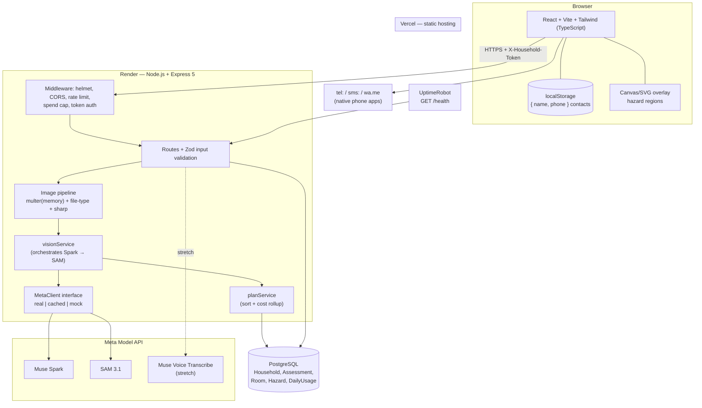
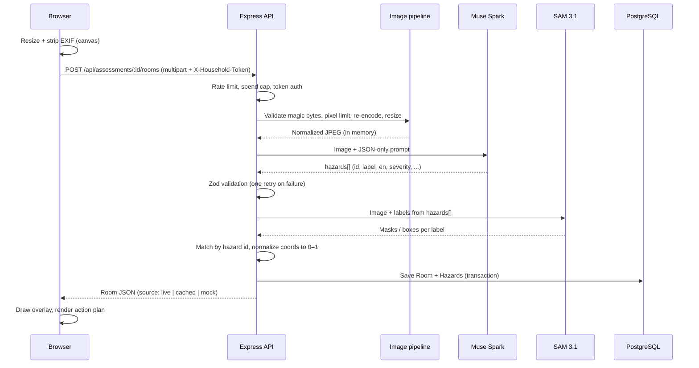

# ARCHITECTURE

> **aegis-home** — a Spanish-language assistant that turns photos of a home into a prioritized, localized fall-prevention plan for older adults and their families.
> Built for the Meta Global AI Developer Hackathon 2026 · Indie Developer track · Theme: *Build for Your World*.

Related documents: [DATA_MODEL.md](DATA_MODEL.md) · [AI_INTEGRATION.md](AI_INTEGRATION.md) · [API_SPECS.md](API_SPECS.md) · [SECURITY.md](SECURITY.md) · [DEVELOPMENT_PLAN.md](DEVELOPMENT_PLAN.md)

Items marked **⚠️ VERIFY** rely on information that must be confirmed in the official Meta docs (`dev.meta.ai/docs`) or the hackathon portal before being treated as fact.

---

## 1. Purpose and scope

**Problem.** Falls are a leading cause of injury among older adults, and most home-hazard assessments require an in-person visit. Existing tools (home-safety scanners, fall-detection cameras) are English-first, priced and contextualized for the US market.

**What the product does.**
1. A family member photographs the rooms of an older adult's home.
2. Muse Spark (vision) identifies fall hazards and drafts fixes; SAM 3.1 segments each hazard so it can be highlighted on the photo.
3. The app produces a prioritized action plan in Spanish with locally relevant materials and cost estimates, and lets the family track what has been fixed.
4. A quick-contact button opens a call / WhatsApp / SMS (with location) to a family member.

**What it deliberately is not.**
- Not a medical device, diagnosis, or health-advice tool. It reports *environmental* hazards only.
- Not an emergency service. The contact button is a shortcut to the user's own contacts via native phone links. It does not monitor, dispatch, or guarantee a response.
- Not a fall *detector*. That market is served by cameras and wearables; this project focuses on prevention.

## 2. Hackathon fit

| Item | Choice |
|---|---|
| Track | Indie Developer |
| Problem statement | *Build for Your World* |
| Meta tools used | Muse Spark (vision + reasoning) and SAM 3.1 via Meta Model API; Muse Voice Transcribe (stretch goal) |
| Differentiators | Spanish-first, LatAm context and costs, visual hazard overlay, follow-up plan, privacy-first (no photos stored) |

## 3. Architectural style

**Modular monolith (SPA + REST API), stateless backend, AI via hosted API.**

Why: a 7-day build window, one developer, and no need to host models. A single deployable backend with clear internal modules is the fastest path, and statelessness leaves a clean path to scale later.

## 4. System diagram



## 5. Components

### 5.1 Frontend (`client/`)
- React + Vite + Tailwind, TypeScript strict.
- **State:** TanStack Query for server data; local component state for UI. No global store.
- **Flat component folder** (no atomic-design tiers): `HazardCard`, `SeverityBadge`, `ImageCanvasOverlay`, `ActionItemRow`, `EmergencyContactButton`, `RoomUploader`, plus `pages/AssessmentPage`.
- **Client-side image prep:** resize via `<canvas>` and re-encode to a Blob, which also strips EXIF/GPS. This protects the honest user's privacy; it is **not** a security control (the server repeats it).
- **Overlay rendering:** regions arrive normalized (0–1) and are scaled to the displayed image size. Coordinates are validated as finite numbers before being placed in SVG attributes.
- **Contacts:** `{ name, phone }` only, in `localStorage`. Phone numbers are validated before building `tel:` / `sms:` / `wa.me` links; message text is passed through `encodeURIComponent`. Geolocation is requested only when the user taps the button.

### 5.2 Backend (`server/`)
- Node.js + Express 5 (async errors handled natively), TypeScript strict, run with `tsx`.
- REST, ~8 endpoints (see [API_SPECS.md](API_SPECS.md)). Route files hold route + handler + input validation; there is no separate controller layer.
- Prisma is called directly from services; no repository wrapper.
- The only abstraction worth its cost is the **`MetaClient` interface** with real and mock implementations (see [AI_INTEGRATION.md](AI_INTEGRATION.md)).

### 5.3 Database
PostgreSQL (managed free tier — Neon or Supabase; **⚠️ VERIFY** free-tier limits and expiry, and avoid a tier that expires mid-judging). Stores structured results only; **no images**. Details in [DATA_MODEL.md](DATA_MODEL.md).

### 5.4 External services
- **Meta Model API** — Muse Spark, SAM 3.1, (stretch) Muse Voice Transcribe.
- **UptimeRobot** (or external cron) — keeps the free Render instance awake via `/health`.
- No queue, cache server, object storage, or paid SMS provider in the MVP.

## 6. Repository layout

```
/
├── client/
│   └── src/
│       ├── components/        # flat, ~8 components
│       ├── pages/             # AssessmentPage, LandingPage
│       ├── hooks/             # useGeolocation, useAssessment
│       └── services/          # API client
├── server/
│   ├── prisma/                # schema.prisma + migrations
│   ├── fixtures/              # recorded real AI responses (own/consented images only)
│   ├── scripts/               # record-fixture, smoke-test
│   ├── src/
│   │   ├── config/            # env validated with Zod
│   │   ├── routes/            # route + handler + input schema
│   │   ├── services/          # visionService, planService, householdService
│   │   ├── lib/               # metaClient, mockMetaClient, prisma, imagePipeline
│   │   ├── schemas/           # Zod: AI contract, API inputs
│   │   ├── middlewares/       # rateLimit, upload, spendCap, auth, errorHandler
│   │   └── app.ts
│   └── tests/
├── docs/ (or repo root)       # these documents
└── README.md
```

## 7. Key flow: analyzing a room



Details of each AI step, validation, and fallbacks: [AI_INTEGRATION.md](AI_INTEGRATION.md).

## 8. Resilience and degradation ladder

| Level | Trigger | Behavior | User-visible? |
|---|---|---|---|
| 0 | Normal | Live Spark → SAM | No |
| 1 | Invalid JSON from Spark | One retry with a stricter reminder | No |
| 2 | SAM fails or returns nothing for a hazard | Hazard shown in the plan **without** overlay region | Subtle (no highlight) |
| 3 | 429 / timeout / spend cap reached | Serve recorded fixture matching the image hash, if any | **Yes — banner** |
| 4 | No fixture available | Serve generic sample result for the room type | **Yes — banner** |

Every response carries `source: "live" | "cached" | "mock"`. When it is not `live`, the UI shows a visible notice such as *"Example result — the analysis service is unavailable."* The demo video must be recorded with **live** calls.

## 9. Deployment and operations

| Part | Host | Notes |
|---|---|---|
| Frontend | Vercel | Security headers/CSP in `vercel.json`; no cold start |
| Backend | Render (free) | Cold start of up to ~50 s after 15 min idle |
| Database | Managed PostgreSQL | SSL required; least-privilege app user |
| Keep-alive | UptimeRobot, `GET /health` every 5 min | Active from first deploy through judging (Nov 4–9); `/health` touches no DB and no AI |

Operational notes:
- Deploy a "hello world" with CORS, env vars and DB by **Fri Oct 30**, so deployment surprises appear early.
- ⚠️ VERIFY in Render docs: whether keeping a free service awake consumes the monthly free hours, and RAM limits (memory uploads + `sharp` on a small instance → cap file size at 5 MB and limit concurrent analyses to 2).
- `app.set('trust proxy', 1)` is required so rate limiting sees real client IPs behind Render's proxy.
- Warm the system manually 1–2 minutes before recording the video and do a full dry run.

### Environment variables

| Variable | Where | Secret? |
|---|---|---|
| `NODE_ENV`, `PORT` | server | no |
| `DATABASE_URL` | server | **yes** |
| `FRONTEND_URL` | server (CORS allow-list) | no |
| `META_API_KEY` | server only | **yes** |
| `META_API_BASE_URL` | server | no (⚠️ VERIFY value) |
| `META_MODEL_SPARK`, `META_MODEL_SAM` | server | no (⚠️ VERIFY model IDs) |
| `MOCK_AI` | server | no |
| `AI_DAILY_CALL_CAP` | server | no |
| `HOUSEHOLD_TTL_DAYS` | server | no |
| `VITE_API_URL` | client | **public by design** — never put secrets in `VITE_*` |

## 10. Design decisions

| Decision | Choice | Reason |
|---|---|---|
| Style | Modular monolith | One dev, 7 days |
| API | REST | ~8 endpoints; GraphQL adds nothing |
| Auth | No accounts; unguessable household token (UUID v4 via `crypto.randomUUID()`) sent in a header | Fastest; shareable with relatives |
| Image storage | None — processed in memory, discarded | Privacy, cost, fewer risks |
| AI pipeline | Sequential: Spark identifies → SAM segments by label | Removes ambiguous matching between text and masks |
| Data layer | Prisma called from services | Fewer layers for a small API |
| Components | Flat folder | Atomic-design tiers cost time without benefit at this size |
| Language | TypeScript strict (client + server). Escape hatch: plain JS + JSDoc if typing slows delivery | Catch contract mismatches early |
| Fallback | Real fixtures first, generic mock last, always labeled | Resilience without misrepresenting the product |

## 11. Scalability path (post-hackathon)

- Stateless API → add instances behind a load balancer.
- Move analysis to a job queue (BullMQ + Redis) with polling/WebSocket for results.
- Cache analyses by image hash.
- If photos are ever stored: object storage with signed URLs and encryption.
- Run open-weight models (Muse Glimmer / Muse Spark Open) on private infrastructure for fully on-premise privacy.

## 12. Provenance (for judges)

All code in this repository was written between **Oct 27 and Nov 4, 2026**. Third-party libraries are declared in `package.json`. Any boilerplate or code reused from earlier work must be listed here: `<!-- fill in; "none" if none -->`.
