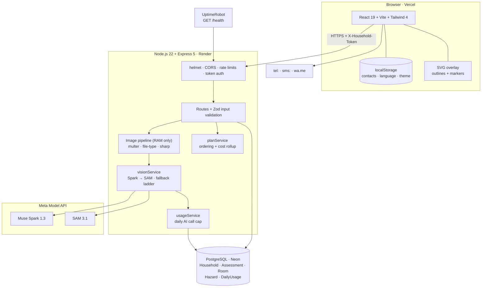
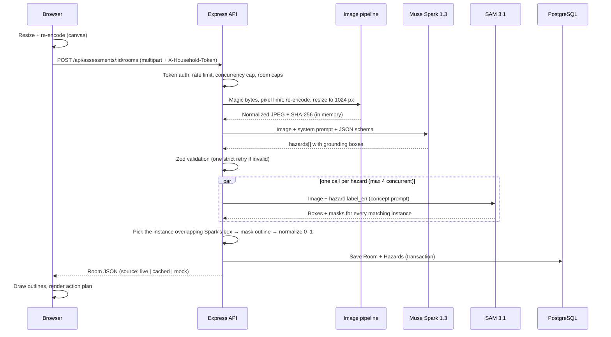

# Architecture

> How aegis-home turns a room photo into an outlined, prioritized plan to fix fall hazards, and why it is built the way it is.

**Related:** [Data model](DATA_MODEL.md) · [AI integration](AI_INTEGRATION.md) · [API specs](API_SPECS.md) · [Security](SECURITY.md) · [Context](CONTEXT.md)

---

## At a glance

| | |
|---|---|
| **Style** | Modular monolith: React SPA + stateless REST API |
| **AI** | Meta Model API, with Muse Spark 1.3 (detection) feeding SAM 3.1 (segmentation) |
| **Data** | PostgreSQL via Prisma. Structured results only; **no images are ever stored** |
| **Auth** | No accounts. Each household has an unguessable UUID token sent in a header |
| **Hosting** | Vercel (frontend) · Render (API) · Neon (Postgres) · UptimeRobot (keep-alive) |
| **Infra cost** | Free tiers. The only variable cost is model calls, bounded by a daily cap |

---

## 1. Scope

**In scope**

1. A family member photographs a room of an older adult's home.
2. **Muse Spark** identifies visible environmental fall hazards and writes a fix, a materials list and a rough cost.
3. **SAM 3.1** segments each hazard so it is outlined on the photo.
4. The app builds an action plan ordered by severity and tracks what has been fixed.
5. A quick-contact button opens call / WhatsApp / SMS to the family's own contacts.

**Out of scope, by design**

| Not this | Why |
|---|---|
| Medical device, diagnosis or health advice | The app reports *environmental* hazards and fixes only |
| Emergency or monitoring service | The contact button is a shortcut to native phone apps; nothing is dispatched or guaranteed |
| Fall detector | Detection is a camera/wearable market; this project focuses on prevention |

---

## 2. System overview



---

## 3. Components

### 3.1 Frontend (`client/`)

| Concern | Implementation |
|---|---|
| Framework | React 19 + Vite + Tailwind 4, TypeScript strict |
| Server state | TanStack Query; local component state for UI; no global store |
| Routing | Small custom router: landing page plus household views at `/h/<token>` (analyze, rooms, plan, settings), lazy-loaded chunks |
| Image prep | Canvas resize (longest side 1600 px) and JPEG re-encode, which drops EXIF/GPS. This is a privacy courtesy; **the server repeats every check**. Bundled samples are sent byte-for-byte so their recorded results match |
| Overlay | Regions arrive normalized (0–1) and are drawn in a `1×1` SVG viewBox stretched over the photo. Coordinates are validated before reaching SVG attributes. Markers are clamped inside the photo and nudged apart when they overlap |
| Contacts | Up to 3 `{ name, phone }` entries in `localStorage` only. Phone numbers are validated, message text is URL-encoded, and location is read only when the user opts in |
| i18n | Spanish (default), Portuguese, English. The initial language follows the browser |

### 3.2 Backend (`server/`)

| Concern | Implementation |
|---|---|
| Runtime | Node.js 22 + Express 5 (native async error handling), TypeScript run with `tsx` |
| Layers | Route files (route + handler + Zod input) → services → Prisma. No controller or repository layer: the API is small |
| AI boundary | A single `MetaClient` interface. The real client calls Meta, tests inject fakes, and `MOCK_AI=true` passes no client, so the fallback ladder takes over |
| Validation | Every request input and every model output goes through Zod before it touches the DB or the response |

### 3.3 External services

| Service | Use |
|---|---|
| Meta Model API | `muse-spark-1.3` over Chat Completions, `sam-3.1` over Responses |
| Neon | Managed Postgres, SSL `verify-full` |
| UptimeRobot | `GET /health` every 5 minutes so the free Render instance stays warm |

The MVP has no queue, cache server, object storage or paid messaging provider.

---

## 4. Repository layout

```
.
├── client/                    # React SPA (Vercel)
│   ├── public/samples/        # two AI-generated sample rooms
│   └── src/
│       ├── components/        # flat: overlay, cards, uploader, contact button…
│       ├── pages/             # landing/ and household/ views
│       ├── hooks/             # useAssessment
│       └── lib/               # api client, image prep, regions, i18n, storage
├── server/                    # Express API (Render)
│   ├── prisma/                # schema + migrations
│   ├── fixtures/              # recorded live results (fallback) + generic samples (MOCK_AI only)
│   ├── scripts/               # smoke-test, record-fixture
│   ├── src/
│   │   ├── config/            # env validated with Zod
│   │   ├── routes/            # households, assessments, hazards, health
│   │   ├── services/          # vision, assessment, household, plan, usage
│   │   ├── lib/               # metaClient, samOutput, sparkPrompt, imagePipeline, regions
│   │   ├── schemas/           # Zod: AI contract, API inputs, enums
│   │   └── middlewares/       # auth, rate limits, concurrency, upload, errors, logging
│   └── tests/                 # Vitest + PGlite
├── docs/                      # these documents
└── .github/workflows/ci.yml   # typecheck · lint · tests · gitleaks
```

---

## 5. Request flow: analyzing a room



Step-by-step AI details: [AI integration](AI_INTEGRATION.md).

---

## 6. Resilience: the degradation ladder

| Level | Trigger | Behavior | Visible to the user |
|---|---|---|---|
| 0 | Normal | Live Spark → SAM, outlines from masks | No |
| 1 | Spark returns invalid JSON | One retry with a strict reminder | No |
| 2 | SAM finds nothing, fails, or the cap is hit after Spark | Hazard kept, with Spark's box as its region | Box instead of outline |
| 3 | 429 after retries, timeout (55 s budget), daily cap | Recorded **real** result for this exact image (SHA-256 match) | **Yes, banner** |
| 4 | No recording for this image | **No result**: HTTP 502 with "try again in a minute"; nothing is saved and the photo stays selected for a one-tap retry | **Yes, error message** |

Generic per-room samples are served **only in `MOCK_AI` mode** (local development without a key). In live mode they would describe some other room on the user's own photo, which reads as a real, wrong analysis.

Every room carries `source: live | cached | mock`. A non-live result is **always** labeled. It is never presented as live AI.

---

## 7. Deployment

| Part | Host | Configuration |
|---|---|---|
| Frontend | Vercel | Root `client/`; [`client/vercel.json`](../client/vercel.json) sets the CSP, `no-referrer` and `noindex` |
| API | Render (free web service) | [`render.yaml`](../render.yaml); migrations run in the build over Neon's direct host (a pooled connection can leak the migration lock); health check `/health` |
| Database | Neon Postgres | `DATABASE_URL` with `sslmode=verify-full` |
| Keep-alive | UptimeRobot | `GET /health` every 5 minutes (no DB or AI access) |

Operational notes:

- `app.set("trust proxy", 1)` lets rate limits see real client IPs behind Render's proxy.
- Memory is bounded on the small instance: 5 MB uploads, at most 2 concurrent analyses.
- After each deploy, run `npm run smoke-test -- https://<api-url>`.

Environment variables are listed in the [README](../README.md#environment-variables). Secrets (`DATABASE_URL`, `META_API_KEY`) live only in the backend environment; nothing secret is ever placed in `VITE_*`.

---

## 8. Design decisions

| Decision | Choice | Rationale |
|---|---|---|
| Architectural style | Modular monolith | One developer, one week; a single deployable with clear internal modules |
| API | REST, 8 endpoints | GraphQL would add nothing at this size |
| Identity | Household token (UUID v4) in a header | Zero sign-up friction; shareable with relatives; scoped queries prevent IDOR |
| Images | Processed in memory, discarded | Privacy, cost, and no storage to secure |
| AI pipeline | Spark identifies → SAM segments **by label** → join by hazard id | No ambiguous matching between descriptions and masks |
| Instance choice | IoU between Spark's box and each SAM instance | A concept prompt returns *every* rug; this picks the one Spark described |
| Region format | Normalized 0–1 bbox or polygon (≤ 100 vertices) | Resolution-independent, small, easy to validate |
| Data access | Prisma from services, no repository layer | Fewer layers for a small API |
| Fallback | A real recording of the same photo, always labeled; otherwise an honest, retryable error | Resilience without ever showing another room's hazards on the user's photo |
| Cost control | Daily AI call cap stored in Postgres | Survives restarts; Meta's spend notification does not stop billing |

---

## 9. Scaling path

| Need | Next step |
|---|---|
| More traffic | Stateless API → horizontal instances behind a load balancer |
| Long analyses | Job queue (e.g. BullMQ + Redis) with polling or WebSocket results |
| Repeated photos | Cache analyses by image hash (the hash is already computed) |
| Stored photos (if ever needed) | Object storage with encryption and signed URLs |
| Full data residency | Self-hosted open-weight models (Muse Spark Open) on private infrastructure |
