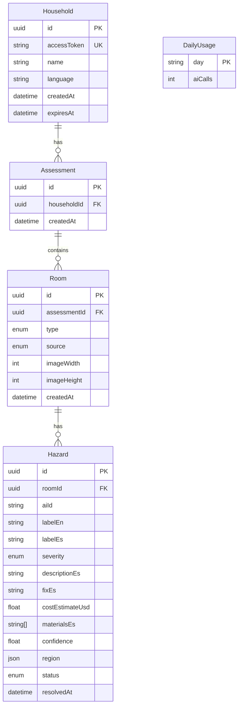

# DATA_MODEL

Related: [ARCHITECTURE.md](ARCHITECTURE.md) · [AI_INTEGRATION.md](AI_INTEGRATION.md) · [API_SPECS.md](API_SPECS.md)

## 1. Principles

1. **Store structured results, never images.** Photos are processed in memory and discarded. The database contains labels, severities, text and normalized coordinates only.
2. **Minimum personal data.** No names, addresses, phone numbers, health data or GPS. Emergency contacts live only in the user's browser (`localStorage`).
3. **Everything hangs off a household token.** Every query filters by the household that owns the token, never by a bare record ID (prevents IDOR).
4. **Expiry by default.** Households expire after `HOUSEHOLD_TTL_DAYS` (default 30) and can be deleted on demand.
5. **AI output is untrusted.** It is validated (Zod) before reaching these tables. Text and numbers are bounded.

> Design note: an earlier draft had a separate `ActionItem` table. Since each hazard has exactly one recommended fix, the fix, cost and status are folded into `Hazard`. Fewer tables, simpler endpoints.

## 2. Entity-relationship diagram



`DailyUsage` is standalone: it backs the global daily spend cap.

## 3. Prisma schema

```prisma
generator client {
  provider = "prisma-client-js"
}

datasource db {
  provider = "postgresql"
  url      = env("DATABASE_URL")
}

enum RoomType {
  BATHROOM
  KITCHEN
  BEDROOM
  LIVING_ROOM
  HALLWAY
  STAIRS
  ENTRANCE
  OUTDOOR
  OTHER
}

enum Severity {
  LOW
  MEDIUM
  HIGH
}

enum HazardStatus {
  PENDING
  RESOLVED
}

enum AnalysisSource {
  LIVE
  CACHED
  MOCK
}

model Household {
  id          String       @id @default(uuid())
  accessToken String       @unique            // crypto.randomUUID(); shared in the app link
  name        String?      @db.VarChar(80)    // optional label, e.g. "Abuela's house"
  language    String       @default("es") @db.VarChar(5)
  createdAt   DateTime     @default(now())
  expiresAt   DateTime
  assessments Assessment[]

  @@index([expiresAt])
}

model Assessment {
  id          String    @id @default(uuid())
  householdId String
  household   Household @relation(fields: [householdId], references: [id], onDelete: Cascade)
  createdAt   DateTime  @default(now())
  rooms       Room[]

  @@index([householdId])
}

model Room {
  id           String         @id @default(uuid())
  assessmentId String
  assessment   Assessment     @relation(fields: [assessmentId], references: [id], onDelete: Cascade)
  type         RoomType
  source       AnalysisSource // LIVE | CACHED | MOCK — shown to the user when not LIVE
  imageWidth   Int            // dimensions of the normalized image the regions refer to
  imageHeight  Int
  language     String         @default("es") // language of the hazard text: es | pt | en
  createdAt    DateTime       @default(now())
  hazards      Hazard[]

  @@index([assessmentId])
}

model Hazard {
  id              String       @id @default(uuid())
  roomId          String
  room            Room         @relation(fields: [roomId], references: [id], onDelete: Cascade)
  aiId            String       @db.VarChar(20)   // "h1", "h2" … the id used to match Spark ↔ SAM
  labelEn         String       @db.VarChar(60)
  labelEs         String       @db.VarChar(60)
  severity        Severity
  descriptionEs   String       @db.VarChar(300)
  fixEs           String       @db.VarChar(300)
  costEstimateUsd Float        @default(0)
  materialsEs     String[]     @default([]) // short shopping list for the fix; [] when none
  confidence      Float
  region          Json?        // normalized 0–1, see §4; null when SAM found nothing
  status          HazardStatus @default(PENDING)
  resolvedAt      DateTime?

  @@unique([roomId, aiId])
  @@index([roomId, status])
}

model DailyUsage {
  day     String @id   // "YYYY-MM-DD" (UTC)
  aiCalls Int    @default(0)
}
```

## 4. `Hazard.region` format

Coordinates are **normalized to 0–1** relative to the normalized image (`Room.imageWidth` × `Room.imageHeight`), so they render correctly at any display size.

```jsonc
// bounding box: [x, y, width, height]
{ "type": "bbox", "points": [0.12, 0.55, 0.30, 0.18] }

// polygon: flat list [x1, y1, x2, y2, ...]
{ "type": "polygon", "points": [0.10, 0.50, 0.40, 0.52, 0.38, 0.70, 0.11, 0.68] }
```

Validation rules (enforced by Zod before saving):
- `type` ∈ `bbox | polygon`.
- Every value is a finite number in `[0, 1]`.
- `bbox` has exactly 4 values; `polygon` has an even count, 6–200 values.
- If SAM returns a pixel-space mask/box, the adapter converts it to this format (⚠️ VERIFY SAM 3.1 output shape — see [AI_INTEGRATION.md](AI_INTEGRATION.md)).

## 5. Derived data (not stored)

- **Action plan order:** hazards sorted by `severity` (HIGH → LOW), then `confidence` descending.
- **Totals:** sum of `costEstimateUsd` for `PENDING` hazards; count resolved vs. pending.
- **Home safety progress:** `resolved / total`.

## 6. Indexes and constraints

| Index / constraint | Purpose |
|---|---|
| `Household.accessToken` unique | Token lookup on every request |
| `Household.expiresAt` | Cleanup of expired households |
| `Assessment(householdId)` | List a household's assessments |
| `Room(assessmentId)` | List rooms of an assessment |
| `Hazard(roomId, status)` | Plan queries |
| `Hazard(roomId, aiId)` unique | Prevent duplicate AI ids within a room |

Cascade deletes: deleting a household removes its assessments, rooms and hazards.

## 7. Retention and deletion

- Default TTL: `HOUSEHOLD_TTL_DAYS` (30). Expired rows are removed **lazily**: each `POST /api/households` deletes households past `expiresAt`.
- On-demand deletion: `DELETE /api/households/me` removes everything for that token.
- Logs never contain coordinates, hazard text, tokens, or request bodies.

## 8. What is explicitly NOT stored

Photos · EXIF/GPS · addresses · phone numbers · health or mobility questionnaires · voice recordings · IP addresses (beyond transient rate-limit counters in memory).

## 9. Conventions

- Enums are uppercase in the DB and lowercase in the API (`HIGH` ↔ `"high"`); the mapping lives in one place (`schemas/`).
- Money: `costEstimateUsd` is an approximate estimate in USD for the demo. Localization of currency is a future improvement.
- Migrations: `prisma migrate dev` locally, `prisma migrate deploy` in the deploy step. Use only Prisma query methods; no raw SQL.
- The DB connection requires SSL, and the app user has the minimum privileges needed (no superuser).
