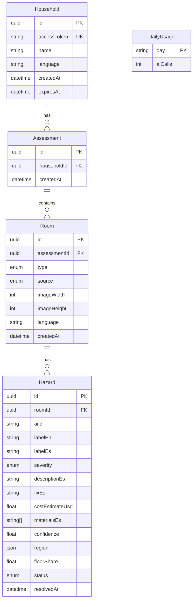

# Data Model

> What aegis-home stores, what it deliberately never stores, and how each record is scoped, validated and expired.

**Related:** [Architecture](ARCHITECTURE.md) · [AI integration](AI_INTEGRATION.md) · [API specs](API_SPECS.md) · [Security](SECURITY.md)

---

## 1. Principles

| # | Principle | How it is enforced |
|---|---|---|
| 1 | **Structured results, never images** | Photos live in memory during analysis only; the DB holds labels, text and normalized coordinates |
| 2 | **Minimum personal data** | No resident names, addresses, phone numbers, health data or GPS. Contacts stay in the browser |
| 3 | **Everything hangs off a household** | Every query filters by the household that owns the token, never by a bare record ID (prevents IDOR) |
| 4 | **Expiry by default** | Households expire after `HOUSEHOLD_TTL_DAYS` (30) and can be deleted on demand |
| 5 | **Model output is untrusted** | Validated and length-bounded with Zod before it reaches any table |

---

## 2. Entity-relationship diagram



`DailyUsage` is standalone: it backs the global daily cap on Meta API calls.

**Why there is no `ActionItem` table:** each hazard has exactly one recommended fix, so the fix, its cost, its materials and its status live in `Hazard`. That means fewer joins and simpler endpoints.

---

## 3. Prisma schema

Source of truth: [`server/prisma/schema.prisma`](../server/prisma/schema.prisma) (Prisma 7; the connection URL is configured in `server/prisma.config.ts`).

```prisma
enum RoomType       { BATHROOM KITCHEN BEDROOM LIVING_ROOM HALLWAY STAIRS ENTRANCE OUTDOOR OTHER }
enum Severity       { LOW MEDIUM HIGH }
enum HazardStatus   { PENDING RESOLVED }
enum AnalysisSource { LIVE CACHED MOCK }

model Household {
  id          String       @id @default(uuid())
  accessToken String       @unique                 // crypto.randomUUID(); shared in the app link
  name        String?      @db.VarChar(80)
  language    String       @default("es") @db.VarChar(5)
  createdAt   DateTime     @default(now())
  expiresAt   DateTime
  assessments Assessment[]

  @@index([expiresAt])
}

model Assessment {
  id          String    @id @default(uuid())
  householdId String
  household   Household @relation(fields: [householdId], references: [id], onDelete: Cascade)
  createdAt   DateTime  @default(now())
  rooms       Room[]

  @@index([householdId])
}

model Room {
  id           String         @id @default(uuid())
  assessmentId String
  assessment   Assessment     @relation(fields: [assessmentId], references: [id], onDelete: Cascade)
  type         RoomType
  source       AnalysisSource                 // shown to the user when not LIVE
  imageWidth   Int                            // normalized image the regions refer to
  imageHeight  Int
  language     String         @default("es")  // language of the hazard text: es | pt | en
  createdAt    DateTime       @default(now())
  hazards      Hazard[]

  @@index([assessmentId])
}

model Hazard {
  id              String       @id @default(uuid())
  roomId          String
  room            Room         @relation(fields: [roomId], references: [id], onDelete: Cascade)
  aiId            String       @db.VarChar(20)    // "h1", "h2"… joins Spark ↔ SAM
  labelEn         String       @db.VarChar(60)    // SAM concept prompt
  labelEs         String       @db.VarChar(60)
  severity        Severity
  descriptionEs   String       @db.VarChar(300)
  fixEs           String       @db.VarChar(300)
  costEstimateUsd Float        @default(0)
  materialsEs     String[]     @default([])
  confidence      Float
  region          Json?                           // see §4
  floorShare      Float?                          // share (0–1) of the visible floor it covers
  status          HazardStatus @default(PENDING)
  resolvedAt      DateTime?

  @@unique([roomId, aiId])
  @@index([roomId, status])
}

model DailyUsage {
  day     String @id          // "YYYY-MM-DD" (UTC)
  aiCalls Int    @default(0)
}
```

> **Naming note:** the `*Es` columns hold text in the room's `language` (Spanish, Portuguese or English). They keep their original names to avoid a breaking migration; `Room.language` records the actual language.

---

## 4. `Hazard.region` format

Coordinates are **normalized to 0–1** relative to the normalized image (`Room.imageWidth × Room.imageHeight`), so they render correctly at any display size.

```jsonc
// Bounding box: [x, y, width, height]
{ "type": "bbox", "points": [0.12, 0.55, 0.30, 0.18] }

// Polygon: flat list [x1, y1, x2, y2, …]
{ "type": "polygon", "points": [0.10, 0.50, 0.40, 0.52, 0.38, 0.70, 0.11, 0.68] }
```

| Rule (enforced by Zod before saving) | |
|---|---|
| `type` | `bbox` or `polygon` |
| Values | Finite numbers in `[0, 1]` |
| `bbox` | Exactly 4 values |
| `polygon` | Even count, 6–200 values (3–100 vertices) |

| Region type | Comes from |
|---|---|
| `polygon` | The outline of SAM 3.1's mask for the matched instance |
| `bbox` | SAM's box when the mask is unusable, or Spark's grounding box when SAM finds nothing |
| `null` | No usable region at all; the hazard still appears in the plan, without a highlight |

---

## 5. Derived data (computed, not stored)

| Value | Definition |
|---|---|
| Plan order | Pending hazards by severity (high → low), then confidence (descending) |
| Pending cost | Sum of `costEstimateUsd` over pending hazards, rounded to cents |
| Progress | Resolved hazards ÷ total hazards |

`Hazard.floorShare` *is* stored: it is measured once from SAM's masks at analysis time and cannot be recomputed later, because the photo is not kept ([AI integration §6.1](AI_INTEGRATION.md#61-floor-share-a-metric-only-masks-can-give)).

---

## 6. Indexes and constraints

| Index / constraint | Purpose |
|---|---|
| `Household.accessToken` unique | Token lookup on every request |
| `Household.expiresAt` | Cleanup of expired households |
| `Assessment(householdId)` | List a household's assessments |
| `Room(assessmentId)` | List an assessment's rooms |
| `Hazard(roomId, status)` | Plan queries |
| `Hazard(roomId, aiId)` unique | No duplicate model ids within a room |

All relations cascade on delete: removing a household removes its assessments, rooms and hazards. A room and its hazards are written in a single nested create.

---

## 7. Retention and deletion

| Mechanism | Behavior |
|---|---|
| TTL | `HOUSEHOLD_TTL_DAYS` (default 30). Expired households are rejected immediately and purged lazily on the next `POST /api/households` |
| On demand | `DELETE /api/households/me` removes everything for that token (the "delete my data" button) |
| Logs | Never contain coordinates, hazard text, tokens or request bodies |

---

## 8. What is never stored

Photos · EXIF/GPS metadata · addresses · phone numbers · contact names · health or mobility data · IP addresses (beyond transient in-memory rate-limit counters).

---

## 9. Conventions

- **Enums** are uppercase in the DB and lowercase in the API (`HIGH` ↔ `"high"`); the mapping lives in one place (`server/src/schemas/enums.ts`).
- **Money:** `costEstimateUsd` is a rough model estimate in USD. Local-currency display is on the roadmap.
- **Migrations:** `prisma migrate dev` locally, `prisma migrate deploy` during the Render build. Only Prisma query methods are used; there is no raw SQL.
- **Connection:** SSL with `sslmode=verify-full`.
